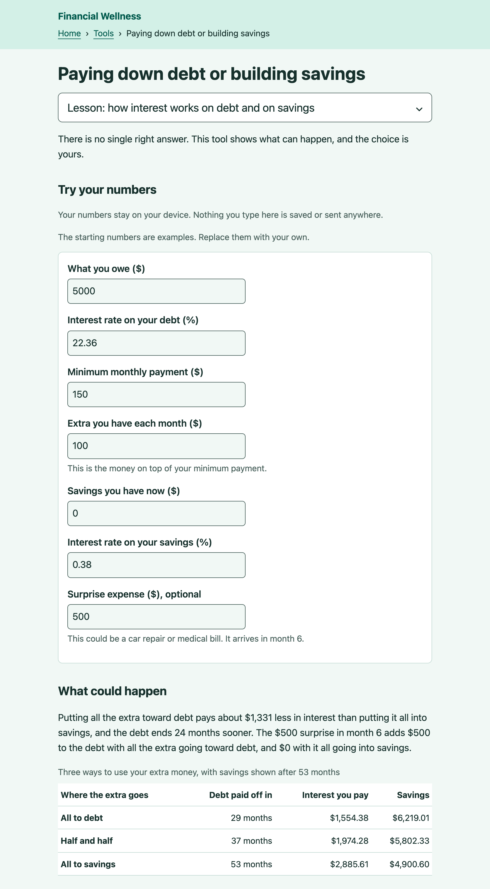

# Financial Wellness App

A free, open-source tool that meets people wherever they are financially. It connects people in crisis to help available today, teaches the basics as they stabilize, and supports them as they build long-term financial security.

**Live site:** [financial-wellness-app.pages.dev](https://financial-wellness-app.pages.dev)

## Status

**In progress.** Phase 1 is live with three calculators, each with a short lesson. It hasn't been shared widely yet. First come testing with screen reader users and a review of the wording by a qualified person.

## Who it's for and the problem it solves

People who are struggling financially often don't know which public programs they qualify for. That information is spread across agencies, each with its own rules and applications. People who are more stable still lack simple, trustworthy tools that aren't selling something. Most financial apps are built to sell products, not to serve the people with the least.

The project is designed around three stages, and people can start at whichever one fits them:

1. **In crisis: connect to help available today.** A guided intake that matches people to food, housing, utility, healthcare, and cash assistance programs, with clear next steps. *(Planned for Phase 2, starting in Multnomah County, Oregon.)*
2. **Stabilizing: learn the basics.** Short, plain-language lessons paired with calculators for budgeting, debt, saving, and credit. *(Being built now.)*
3. **Planning ahead: build long-term security.** Education and tools for goals like an emergency fund, retirement, and homebuying. *(Planned for later in Phase 1.)*

Nothing is locked behind another stage. As people stabilize, the site invites them toward the next step.

## What it does today

- **How a credit score affects what you pay:** see what the same car loan costs at different credit scores, using published average rates.
- **Where your money goes each month:** a budget that shows what comes in, what goes out, and what's left, using your own numbers. When costs are higher than income, it says so plainly and points to 2-1-1 for local help.
- **Paying down debt or building savings:** see what happens when extra money goes toward debt, savings, or both. The tool shows the results and leaves the choice to the person.
- **A short lesson above each tool** that explains the idea before people try it with their own numbers.
- **A tools page** that lists the tools from the basics to planning ahead.
- **Anonymous feedback:** a "Was this helpful?" question and an optional goal question after each tool's results.



## Design decisions and tradeoffs

- **The basics come first, the crisis stage second.** Phase 1 builds the stabilizing and planning stages because they don't depend on agency partnerships and can serve anyone, anywhere. Connecting people in crisis to programs carries much higher stakes: wrongly telling someone they qualify, or sending them to a closed office, can do real harm. That stage waits for verified, regularly checked program data, and likely partners. Until it exists, the budget tool points people who are short each month to 2-1-1. Within the basics, credit scores and the choice between paying down debt and saving came first, because conversations with many people about money basics kept pointing to those topics. Building started on that evidence, without a separate round of validation interviews, and feedback from a small group comes once the launch checks are done.
- **Education, not advice. Tools show, people choose.** Calculators use the person's own numbers and never recommend a product, company, or investment. The budget tool deliberately shows no target percentages such as 50/30/20. Rent alone often takes more than half of a low income, and a target could make people feel they're failing at something they can't control. Retirement tools come last because they carry the most risk of reading like advice, and they wait for a qualified review of the wording.
- **Privacy by default.** There are no accounts, and nothing a person types is stored on a server. Saving a budget is opt-in, stays on that device, and comes with a warning about shared computers. Success is measured with anonymous totals (no cookies) and answers given by tapping a button. The tradeoff is that the project can't follow any one person's progress, so it asks people directly whether they've moved on to a new goal.
- **Dignity in the details.** The site uses plain language and avoids industry labels like "subprime." Tool groups are named by topic, never by the person's level. Example amounts are left out of the budget because they can feel presumptuous.
- **Accessibility and sourced numbers are requirements, not extras.** Every page aims to meet WCAG 2.2 Level AA. Every rate comes from a named public source (Experian, the Federal Reserve, the FDIC) with a date. A monthly check proposes updates, and a person reviews each one.

**Deliberately not built:** accounts, ads or any revenue model, tracking of individuals, product recommendations, and target percentages. A home page quiz is also on hold until there are about five or six tools for it to suggest. The site is English only for now.

## Roadmap

1. **Launch checks:** screen reader testing, a full accessibility review, real-device testing, and a qualified review of the wording ([#16](https://github.com/natalia-builds/financial-wellness-app/issues/16)). Then share with a small group and gather feedback.
2. **Savings goal tool** with a lesson ([#35](https://github.com/natalia-builds/financial-wellness-app/issues/35)).
3. **Quiz and a two-part home page** that suggest tools without steering ([#36](https://github.com/natalia-builds/financial-wellness-app/issues/36)).
4. **First retirement tool** ([#20](https://github.com/natalia-builds/financial-wellness-app/issues/20) or [#21](https://github.com/natalia-builds/financial-wellness-app/issues/21)), after the wording review.
5. **Phase 2: connecting people in crisis to programs in Multnomah County.** Open questions include where program data comes from ([#3](https://github.com/natalia-builds/financial-wellness-app/issues/3)) and who maintains the project long term ([#4](https://github.com/natalia-builds/financial-wellness-app/issues/4)).

## Limitations and known gaps

- **The crisis stage isn't built.** Today it's a pointer to 2-1-1, not program matching.
- **Accessibility isn't fully verified.** Each change gets automated and manual checks, but there's been no full WCAG 2.2 AA review and no testing by someone who uses a screen reader every day.
- **The wording hasn't had a qualified review yet.**
- **There's no user feedback yet**, because the site hasn't been shared widely.
- **Rates are national averages**, checked monthly. Real loan offers vary.
- **A saved budget lives in one browser.** Clearing the browser or switching devices loses it.
- **English only**, with no decision yet on other languages.
- **Long-term maintenance is undecided** ([#4](https://github.com/natalia-builds/financial-wellness-app/issues/4)).

---

## For developers

Built with [Astro](https://astro.build) and hosted on Cloudflare Pages, which publishes `main` automatically. Interactive components come from [Accessible Astro Components](https://github.com/incluud/accessible-astro-components). Tests use [Vitest](https://vitest.dev).

### Run it on your computer

You'll need [Node.js](https://nodejs.org) installed.

```bash
npm install      # download the packages the project needs
npm run dev      # start a private preview at http://localhost:4321
npm test         # run the automated tests
npm run build    # build the finished website
```

### Where things live

- [Concept brief](docs/concept-brief.md): vision, principles, decisions, and current status (the source of truth)
- [Operations](docs/operations.md): publishing, the monthly rate check, counting visits, and the Design System
- [Accessibility checks](docs/accessibility-checks.md): what to run before every pull request
- `src/data/`: published rates, each with its source, period, and date checked
- `src/text/en.ts`: all user-facing wording, kept separate from code
- `src/lib/`: calculations and their tests

### Contributing

Issues are welcome. [Open one](https://github.com/natalia-builds/financial-wellness-app/issues) to report a problem, flag a confusing word, or suggest an idea. Open work is tracked there too. [CLAUDE.md](CLAUDE.md) has the working rules the project follows.

### License

[MIT](LICENSE)
